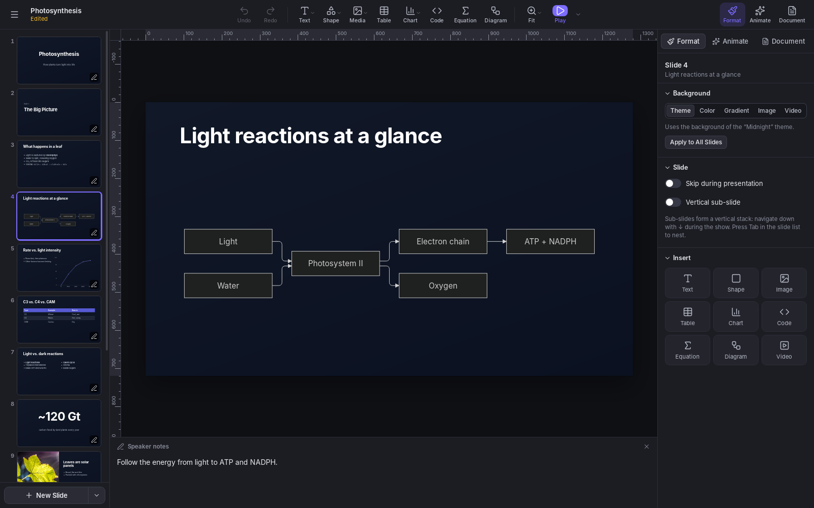
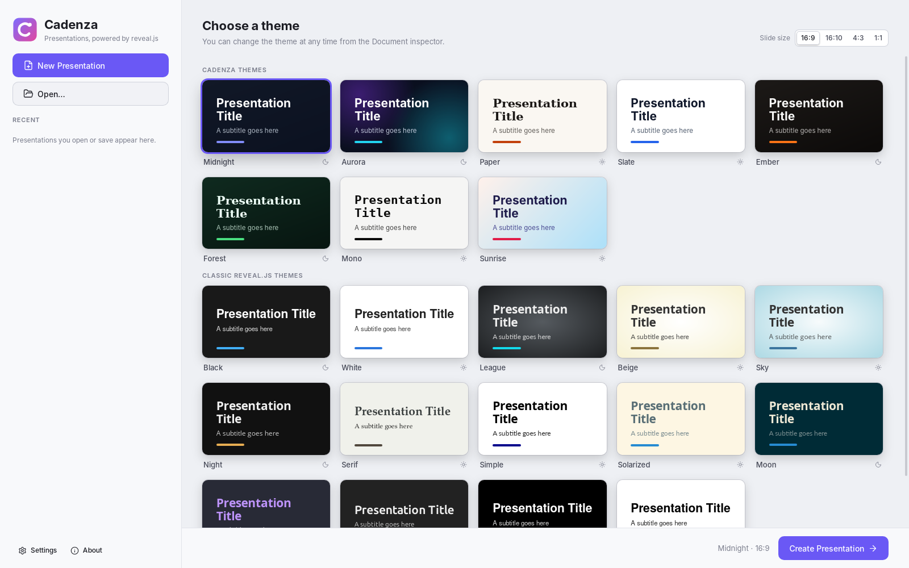
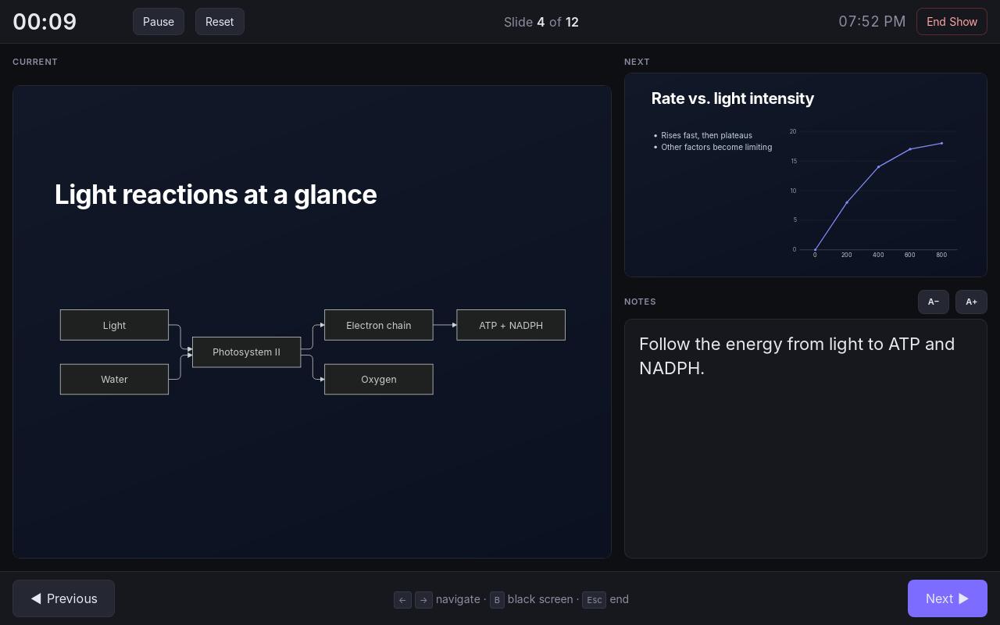

+++
title = "Cadenza"
description = "A presentation app for Linux, macOS and Windows in the spirit of Keynote and PowerPoint, built on reveal.js and written in Rust"
date = "2026-10-13"
weight = 0

[taxonomies]
tags=["rust", "reveal.js", "presentations", "open source"]

[extra]
toc = true

+++

**Cadenza** is a presentation app in the spirit of Keynote and PowerPoint, built on [reveal.js](https://revealjs.com). You build slides from ready-made layouts, themes, charts, diagrams and equations, present them full screen with a presenter display, and export the result as a web page or PDF.

It runs on Linux, macOS and Windows, works offline, and keeps each presentation in a single file with its images, videos and fonts. It is open source, written in Rust with [Tauri](https://tauri.app), and released under the MIT License.

<figure style="width:85%; height:auto; max-width:85%; display:block; margin: 0 auto;">
  
  <figcaption style="margin-top: 1px; font-size: 0.8em; color: #555; line-height:1.5;">Editing a slide with a Mermaid diagram. Photo on slide 9: “Life is Beautiful” by Gabe Kronisch, CC BY 2.0
  </figcaption>
</figure>

# Download

**Version 0.2.1**, released October 14, 2026 ([what's new][whats-new] · [earlier versions][releases]).

| System | Download |
|--------|----------|
| Windows 10 and 11 | [Installer (.exe)][exe] · [MSI package][msi] |
| macOS 12 or newer (Apple Silicon and Intel) | [Disk image (.dmg)][dmg] |
| Ubuntu, Debian and derivatives | [.deb package][deb] |
| Fedora and openSUSE | [.rpm package][rpm] |
| Any Linux | [AppImage][appimage] |

[whats-new]: https://github.com/rodolfo-viana/cadenza/releases/tag/v0.2.1
[releases]: https://github.com/rodolfo-viana/cadenza/releases
[exe]: https://github.com/rodolfo-viana/cadenza/releases/download/v0.2.1/Cadenza_0.2.1_x64-setup.exe
[msi]: https://github.com/rodolfo-viana/cadenza/releases/download/v0.2.1/Cadenza_0.2.1_x64_en-US.msi
[dmg]: https://github.com/rodolfo-viana/cadenza/releases/download/v0.2.1/Cadenza_0.2.1_universal.dmg
[deb]: https://github.com/rodolfo-viana/cadenza/releases/download/v0.2.1/Cadenza_0.2.1_amd64.deb
[rpm]: https://github.com/rodolfo-viana/cadenza/releases/download/v0.2.1/Cadenza-0.2.1-1.x86_64.rpm
[appimage]: https://github.com/rodolfo-viana/cadenza/releases/download/v0.2.1/Cadenza_0.2.1_amd64.AppImage

## Installing

- **Windows:** run the installer. It installs Microsoft WebView2 if needed.
- **macOS:** open the `.dmg` file and drag **Cadenza** to the **Applications** folder.
- **Linux:** install the package from a terminal, in the folder you downloaded it to. The AppImage needs no installation: make it executable and run it.

```sh
sudo apt install ./Cadenza_0.2.1_amd64.deb         # Ubuntu, Debian
sudo dnf install ./Cadenza-0.2.1-1.x86_64.rpm      # Fedora
sudo zypper install ./Cadenza-0.2.1-1.x86_64.rpm   # openSUSE
chmod +x Cadenza_0.2.1_amd64.AppImage              # AppImage
```

The Linux and Windows versions are 64-bit (x86-64). The `.deb` and `.rpm` packages need WebKitGTK 4.1, which comes with Ubuntu 22.04, Debian 12, Fedora 37 and newer.


The installers aren't code-signed yet, so your system asks you to confirm:

- **Windows:** SmartScreen may warn that the app isn't recognized. Click **More info ▸ Run anyway**.
- **macOS:** macOS says it can't verify the app. Open **System Settings ▸ Privacy & Security**, scroll down to the message about **Cadenza** and click **Open Anyway**. You only need to do this once per version.


# Features

## Editing

- Twelve slide layouts (title, section, two columns, quote, big number, code and more), with text, shapes, images, video, tables, charts, code, equations and diagrams.
- Column, bar, line, area, pie and donut charts, edited in a data grid and drawn as SVG.
- Code with syntax highlighting, line numbers and step-by-step line highlights.
- LaTeX equations with KaTeX, as objects or inside any text: `$e^{i\pi}+1=0$`.
- [Mermaid](https://mermaid.js.org) diagrams: flowcharts, sequence diagrams, timelines, mind maps and more.
- Rulers, draggable guides, smart guides and a snapping grid.
- Undo and redo for everything, a command palette (Ctrl+K, or ⌘K on a Mac) and keyboard shortcuts for all common actions.

## Design

- 22 themes: 8 made for **Cadenza** plus the classic reveal.js themes.
- A Theme Builder to make your own and share them as `.cadenza-theme` files (fonts included) or export them as reveal.js CSS.
- Every Google Fonts family, searchable even offline. The fonts you pick are embedded in the presentation, so it looks the same on any computer.
- Step-by-step builds, slide transitions and Magic Move (reveal.js auto-animate).
- Per-presentation custom CSS for anything else.

<figure style="width:85%; height:auto; max-width:85%; display:block; margin: 0 auto;">
  
  <figcaption style="margin-top: 1px; font-size: 0.8em; color: #555; line-height:1.5;">Choosing a theme for a new presentation, with the interface in light mode
  </figcaption>
</figure>

## Media

- A Media Library with openly licensed photos and GIFs from Openverse, plus Unsplash and GIPHY with a free API key.
- YouTube and Vimeo videos: browse the sites as usual and click **Insert this video**, or just paste a link. No key needed.

## Presenting and sharing

- Full-screen shows with a presenter display: speaker notes, timer, clock and the next slide. With two screens, the audience sees the slides on one while you see the presenter display on the other.
- A teleprompter in the presenter display that scrolls each slide's speaker notes as you present. Put it anywhere on the screen, resize it, and set its speed, font, text size and colors. The audience never sees it.
- With one screen, press X during the show to switch between the slides and the presenter display. In a video call, share only the presentation window.
- Vertical sub-slides, skipped slides and auto-advance.
- Export to a web page, either as a folder for any web server or as a single `.html` file, or print to PDF.
- Import reveal.js-style Markdown.
- Recovery of unsaved work after a crash.

<figure style="width:85%; height:auto; max-width:85%; display:block; margin: 0 auto;">
  
  <figcaption style="margin-top: 1px; font-size: 0.8em; color: #555; line-height:1.5;">The presenter display, with the current and next slides, speaker notes and the timer
  </figcaption>
</figure>

## Languages

The interface is available in Arabic, Bengali, Chinese (Simplified), Dutch, English, French, German, Hindi, Italian, Japanese, Polish, Portuguese, Portuguese (Brazil), Russian, Spanish and Turkish. English is the default; change it in **Settings ▸ Language**.

# Privacy

**Cadenza** works fully offline. Online features (Google Fonts downloads, the Media Library and video previews) contact a service only when you use them. API keys are stored in your system's credential store (Secret Service on Linux, Keychain on macOS, Credential Manager on Windows) and are never saved inside presentations.

# Files

- **`.cadenza`**: a presentation, stored as a zip archive with `deck.json` and the media and fonts it uses.
- **`.cadenza-theme`**: a theme from the Theme Builder (JSON, with its fonts embedded).

# Source code

**Cadenza**'s source code is on [GitHub](https://github.com/rodolfo-viana/cadenza), along with instructions for [building from source](https://github.com/rodolfo-viana/cadenza#building-from-source), the [changelog](https://github.com/rodolfo-viana/cadenza/blob/main/CHANGELOG.md) and the [contribution guide](https://github.com/rodolfo-viana/cadenza/blob/main/CONTRIBUTING.md). Bug reports, suggestions and translations are welcome in the [issues](https://github.com/rodolfo-viana/cadenza/issues).

**Cadenza** is released under the [MIT License](https://github.com/rodolfo-viana/cadenza/blob/main/LICENSE). It includes reveal.js, KaTeX, Mermaid, highlight.js, Preact, htm and Lucide icons, each under its own license.
