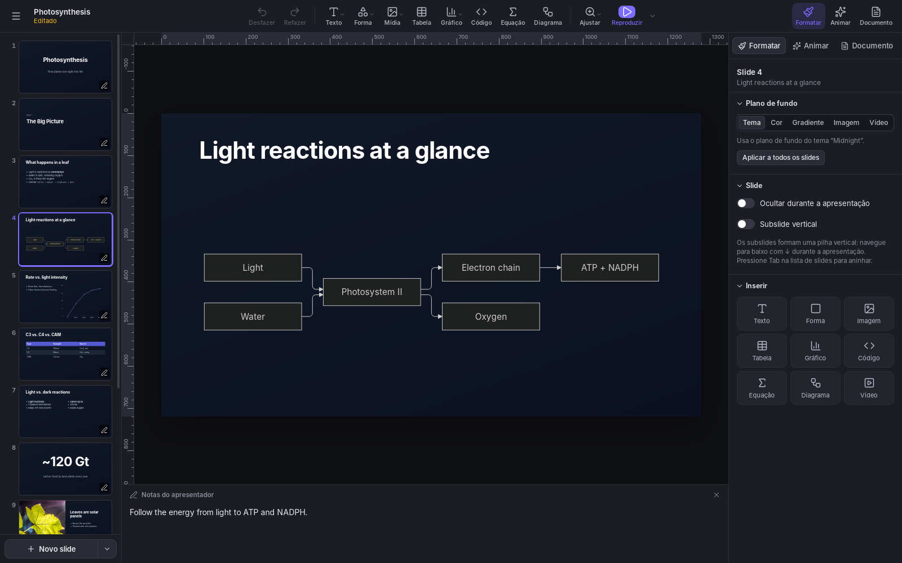
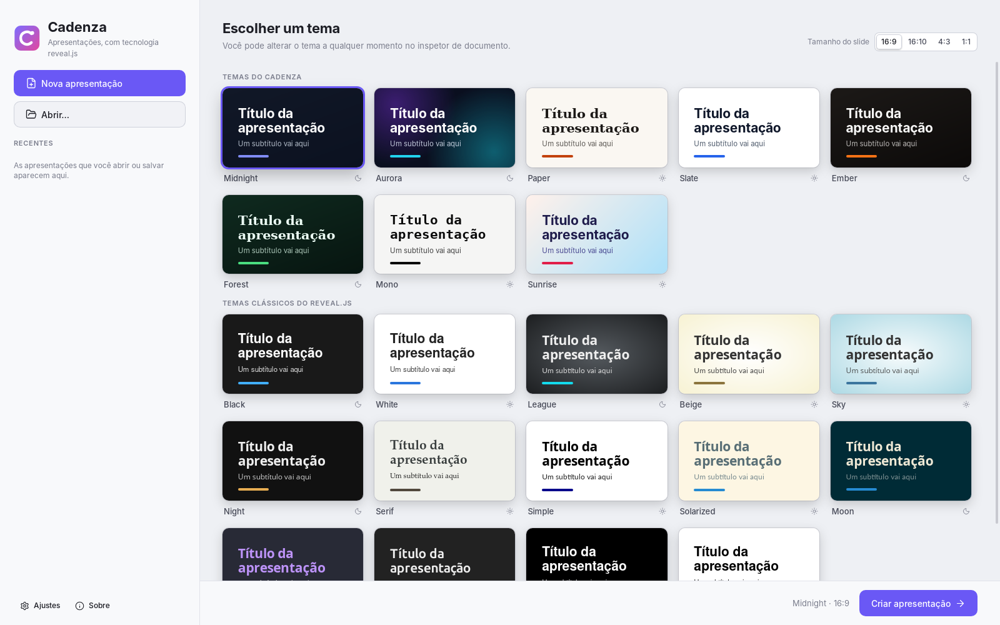
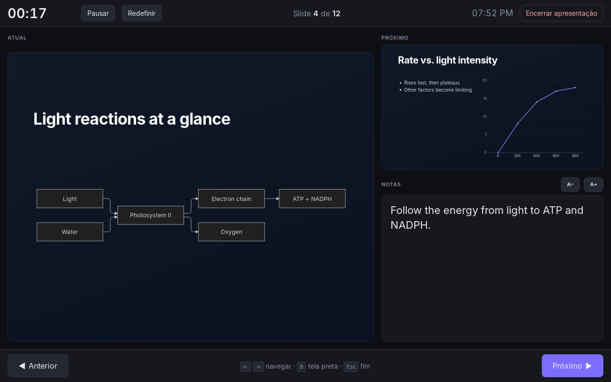

+++
title = "Cadenza"
description = "Aplicativo de apresentações para Linux, macOS e Windows, no espírito do Keynote e do PowerPoint, construído sobre o reveal.js e escrito em Rust"
date = "2026-10-13"
weight = 0

[taxonomies]
tags=["rust", "reveal.js", "apresentações", "software livre"]

[extra]
toc = true

+++

O **Cadenza** é um aplicativo de apresentações no espírito do Keynote e do PowerPoint, construído sobre o [reveal.js](https://revealjs.com). Você monta os slides com layouts prontos, temas, gráficos, diagramas e equações, apresenta em tela cheia com uma tela do apresentador e exporta o resultado como página web ou PDF.

Ele roda no Linux, no macOS e no Windows, funciona offline e guarda cada apresentação num único arquivo, com imagens, vídeos e fontes incluídos. É software livre, escrito em Rust com [Tauri](https://tauri.app) e distribuído sob a licença MIT.

<figure style="width:85%; height:auto; max-width:85%; display:block; margin: 0 auto;">
  
  <figcaption style="margin-top: 1px; font-size: 0.8em; color: #555; line-height:1.5;">Editando um slide com um diagrama Mermaid. Foto do slide 9: "Life is Beautiful", de Gabe Kronisch, <a href="https://creativecommons.org/licenses/by/2.0/">CC BY 2.0</a>
  </figcaption>
</figure>

# Baixar

**Versão 0.2.1**, de 14 de outubro de 2026 ([o que há de novo][novidades] · [versões anteriores][versoes]).

| Sistema | Download |
|---------|----------|
| Windows 10 e 11 | [Instalador (.exe)][exe] · [Pacote MSI][msi] |
| macOS 12 ou mais recente (Apple Silicon e Intel) | [Imagem de disco (.dmg)][dmg] |
| Ubuntu, Debian e derivados | [Pacote .deb][deb] |
| Fedora e openSUSE | [Pacote .rpm][rpm] |
| Qualquer Linux | [AppImage][appimage] |

[novidades]: https://github.com/rodolfo-viana/cadenza/releases/tag/v0.2.1
[versoes]: https://github.com/rodolfo-viana/cadenza/releases
[exe]: https://github.com/rodolfo-viana/cadenza/releases/download/v0.2.1/Cadenza_0.2.1_x64-setup.exe
[msi]: https://github.com/rodolfo-viana/cadenza/releases/download/v0.2.1/Cadenza_0.2.1_x64_en-US.msi
[dmg]: https://github.com/rodolfo-viana/cadenza/releases/download/v0.2.1/Cadenza_0.2.1_universal.dmg
[deb]: https://github.com/rodolfo-viana/cadenza/releases/download/v0.2.1/Cadenza_0.2.1_amd64.deb
[rpm]: https://github.com/rodolfo-viana/cadenza/releases/download/v0.2.1/Cadenza-0.2.1-1.x86_64.rpm
[appimage]: https://github.com/rodolfo-viana/cadenza/releases/download/v0.2.1/Cadenza_0.2.1_amd64.AppImage

## Instalação

- **Windows:** execute o instalador. Ele instala o Microsoft WebView2 se for preciso.
- **macOS:** abra o arquivo `.dmg` e arraste o **Cadenza** para a pasta **Aplicativos**.
- **Linux:** instale o pacote pelo terminal, na pasta onde ele foi baixado. O AppImage não precisa de instalação: basta torná-lo executável e abri-lo.

```sh
sudo apt install ./Cadenza_0.2.1_amd64.deb         # Ubuntu, Debian
sudo dnf install ./Cadenza-0.2.1-1.x86_64.rpm      # Fedora
sudo zypper install ./Cadenza-0.2.1-1.x86_64.rpm   # openSUSE
chmod +x Cadenza_0.2.1_amd64.AppImage              # AppImage
```

As versões para Linux e Windows são de 64 bits (x86-64). Os pacotes `.deb` e `.rpm` precisam do WebKitGTK 4.1, presente no Ubuntu 22.04, no Debian 12, no Fedora 37 e em versões mais recentes.


Os instaladores ainda não têm assinatura digital, então o sistema pede uma confirmação:

- **Windows:** o SmartScreen pode avisar que o aplicativo não é reconhecido. Clique em **Mais informações ▸ Executar assim mesmo**.
- **macOS:** o sistema avisa que não consegue verificar o aplicativo. Abra **Ajustes do Sistema ▸ Privacidade e Segurança**, role até a mensagem sobre o **Cadenza** e clique em **Abrir Mesmo Assim**. É preciso fazer isso só uma vez por versão.


# Recursos

## Edição

- Doze layouts de slide (título, seção, duas colunas, citação, número em destaque, código e outros), com texto, formas, imagens, vídeos, tabelas, gráficos, código, equações e diagramas.
- Gráficos de colunas, barras, linhas, área, pizza e rosca, editados numa planilha e desenhados em SVG.
- Código com destaque de sintaxe, numeração de linhas e realce de linhas passo a passo.
- Equações em LaTeX com KaTeX, como objetos ou dentro de qualquer texto: `$e^{i\pi}+1=0$`.
- Diagramas [Mermaid](https://mermaid.js.org): fluxogramas, diagramas de sequência, linhas do tempo, mapas mentais e outros.
- Réguas, guias arrastáveis, guias inteligentes e grade com encaixe.
- Desfazer e refazer para tudo, paleta de comandos (Ctrl+K, ou ⌘K no Mac) e atalhos de teclado para as ações mais comuns.

## Design

- 22 temas: 8 criados para o **Cadenza** e os temas clássicos do reveal.js.
- Um construtor de temas para criar os seus e compartilhá-los num arquivo `.cadenza-theme` (com as fontes incluídas) ou exportá-los como CSS do reveal.js.
- Todas as famílias do Google Fonts, pesquisáveis mesmo offline. As fontes escolhidas vão dentro da apresentação, que fica igual em qualquer computador.
- Animações passo a passo, transições entre slides e Magic Move (o *auto-animate* do reveal.js).
- CSS próprio em cada apresentação para todo o resto.

<figure style="width:85%; height:auto; max-width:85%; display:block; margin: 0 auto;">
  
  <figcaption style="margin-top: 1px; font-size: 0.8em; color: #555; line-height:1.5;">A escolha de tema ao criar uma apresentação, com a interface no modo claro
  </figcaption>
</figure>

## Mídia

- Biblioteca de mídia com fotos e GIFs de licença aberta do Openverse, além do Unsplash e do GIPHY com uma chave de API gratuita.
- Vídeos do YouTube e do Vimeo: navegue pelos sites como de costume e clique em **Inserir este vídeo**, ou simplesmente cole o link. Não é preciso chave.

## Apresentação e compartilhamento

- Apresentação em tela cheia com uma tela do apresentador: notas, cronômetro, relógio e o próximo slide. Com dois monitores, o público vê os slides num deles e você vê a tela do apresentador no outro.
- Um teleprompter na tela do apresentador, que rola as notas de cada slide enquanto você apresenta. Dá para colocá-lo em qualquer lugar da tela, mudar o tamanho e ajustar a velocidade, a fonte, o tamanho do texto e as cores. O público nunca o vê.
- Com uma só tela, a tecla X alterna entre os slides e a tela do apresentador durante a apresentação. Numa videochamada, compartilhe só a janela da apresentação.
- Subslides verticais, slides ocultos e avanço automático.
- Exportação como página web, numa pasta para qualquer servidor ou num único arquivo `.html`, e impressão em PDF.
- Importação de Markdown no estilo do reveal.js.
- Recuperação do trabalho não salvo depois de uma falha.

<figure style="width:85%; height:auto; max-width:85%; display:block; margin: 0 auto;">
  
  <figcaption style="margin-top: 1px; font-size: 0.8em; color: #555; line-height:1.5;">A tela do apresentador, com o slide atual, o próximo, as notas e o cronômetro
  </figcaption>
</figure>

## Idiomas

A interface está disponível em alemão, árabe, bengali, chinês (simplificado), espanhol, francês, hindi, holandês, inglês, italiano, japonês, polonês, português, português do Brasil, russo e turco. O inglês é o idioma padrão; para trocar, use **Ajustes ▸ Idioma**.

# Privacidade

O **Cadenza** funciona totalmente offline. Os recursos on-line (o download de fontes do Google Fonts, a biblioteca de mídia e as prévias de vídeo) só se conectam a um serviço quando você os usa. As chaves de API ficam no cofre de senhas do sistema (Secret Service no Linux, Acesso às Chaves no macOS, Gerenciador de Credenciais no Windows) e nunca são gravadas nas apresentações.

# Arquivos

- **`.cadenza`**: uma apresentação, guardada como um arquivo zip com o `deck.json` e as mídias e fontes que ela usa.
- **`.cadenza-theme`**: um tema criado no construtor de temas (JSON, com as fontes incluídas).

# Código-fonte

O código do **Cadenza** está no [GitHub](https://github.com/rodolfo-viana/cadenza), com as instruções para [compilar a partir do código-fonte](https://github.com/rodolfo-viana/cadenza#building-from-source), o [histórico de mudanças](https://github.com/rodolfo-viana/cadenza/blob/main/CHANGELOG.md) e o [guia de contribuição](https://github.com/rodolfo-viana/cadenza/blob/main/CONTRIBUTING.md). Relatos de erro, sugestões e traduções são bem-vindos nas [issues](https://github.com/rodolfo-viana/cadenza/issues).

O **Cadenza** é distribuído sob a [licença MIT](https://github.com/rodolfo-viana/cadenza/blob/main/LICENSE). Ele inclui reveal.js, KaTeX, Mermaid, highlight.js, Preact, htm e ícones Lucide, cada um sob a própria licença.
